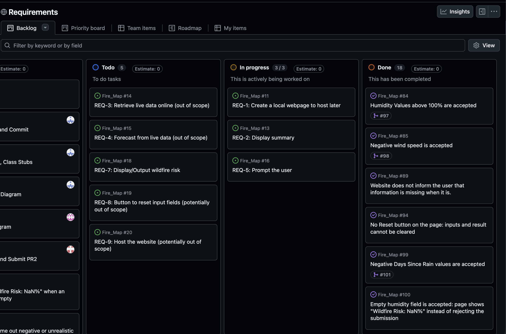

# PR4 Team Report

**Team number:**

**Names:** Noam Garibi, Jacobo Ramos Gracia, Liliana Carrillo, Ryder Garcia

## 1. Bug Triage Table

| Test name | Bucket | Issue link | Severity | Priority | Owner | Status |
|---|---|---|---|---|---|---|
| NG-03: Reset button clears the fields and the result | Code bug | [#94](https://github.com/dcardenas0302/Fire_Map/issues/94) | Low | Medium | Noam Garibi | Fixed on `noam-work`, PR pending |
| RG-02: Empty humidity field is rejected | Code bug | [#100](https://github.com/dcardenas0302/Fire_Map/issues/100) | High | High | Noam Garibi | Fixed on `noam-work`, PR pending |
| RG-04: Negative wind speed is rejected | Code bug | [#85](https://github.com/dcardenas0302/Fire_Map/issues/85) | Medium | High | Ryder Garcia | Fixed, PR [#98](https://github.com/dcardenas0302/Fire_Map/pull/98) merged into `main` |
| RG-05: Negative days since rain is rejected | Code bug | [#99](https://github.com/dcardenas0302/Fire_Map/issues/99) | Medium | Medium | Ryder Garcia | Fixed, PR [#101](https://github.com/dcardenas0302/Fire_Map/pull/101) merged into `main` |
| JR-03: Temperature affects the calculated risk | Code bug | [#72](https://github.com/dcardenas0302/Fire_Map/issues/72) | High | Major | Jacobo Ramos | Fixed, PR[#93](https://github.com/dcardenas0302/Fire_Map/pull/93) merged into `main`|
| RG-03: Humidity Values above 100% are accepted| Code Bug | [#84](https://github.com/dcardenas0302/Fire_Map/issues/84) | High | Medium | Jacobo Ramos | Fixed, PR[#97](https://github.com/dcardenas0302/Fire_Map/pull/97) merged into `main`|

## 2. Regression Log

Test ID

Bug

Red test result

Green test result

Final status

RG-04

Negative wind speed accepted

Failed as expected — Run #124

Passed after validation fix

Merged

RG-05

Negative days since rain accepted

Failed - As expected run #128

Passed — Run #129

Merged

Both regression tests were written to demonstrate the original bugs before the code was fixed. Each test expects the calculator to throw a RangeError when an invalid negative value is provided.

After implementing the fixes, both tests passed. A merge conflict between the two changes was resolved, preserving both validation checks and both regression tests.

## 3. Final Test Run
The team ran the automated test workflow after merging the input-validation fixes.

Final verified run: GitHub Actions Run #137

Branch: main

Workflow: Tests

Trigger: Merge of Pull Request #101

Status: Completed

Conclusion: Success

The final version of tests/risk.test.js contains the RG-04 and RG-05 regression tests. The successful workflow demonstrates that the automated test job passed after both fixes were integrated.

Final team-wide evidence: Update this section with a newer successful workflow if additional teammates' changes are merged afterward.

## 4. Feature Decision

Feature name: Unit toggle (°F and mph, or °C and m/s)

Why we chose it: The page currently tells users to enter everything in metric system, but local weather apps show °F and mph. Those inputs will be converted to metric system before the existing wildfire risk calculation runs, so both settings give the same result and the formula does not change.

Owners:
Jacobo and Noam

Test cases:

1. Enter 86 in the temperature field with °F selected, then switch to metric. The field updates to 30.
2. Enter 86 °F and 22.4 mph, then 30 °C and 10 m/s, with the same humidity and days since rain. Both show the same wildfire risk percentage.

## 5. Board Snapshot

## 6. Sprint Summary

Good communication was key for this push, because we did not want any bug fix to affect existing features or to clash with code from another fresh bug fix. This sprint we fixed six bugs from our Part 6 tests: Jacobo fixed REQ-JR-03, temperature not being used in the formula (#72, PR #93), and REQ-RG-03, humidity above 100% being accepted (#84, PR #97); Noam added the missing Reset button for REQ-NG-03 (#94, PR #102) and made the form reject an empty humidity field for REQ-RG-02 (#100, PR #102); Liliana made the page tell the user which required inputs are blank for LC-03 (#89, PR #96); and Ryder made negative wind speed get rejected for REQ-RG-04 (#85, PR #98), plus negative days since rain, which he found along the way (#99, PR #101). Next sprint, we could look at issue #73 and #71, then build the unit toggle.
