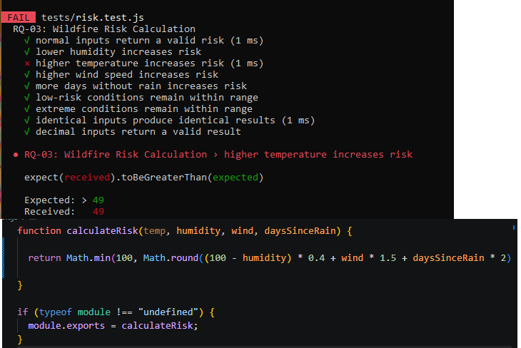
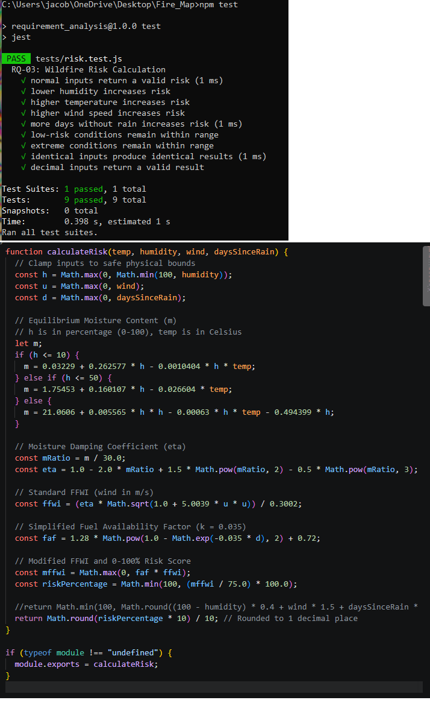

Jacobo Ramos Gracia

### New Formula - Temperature input doesn't affect wildfire risk calculation issue
Issue: https://github.com/dcardenas0302/Fire_Map/issues/72
PR: https://github.com/dcardenas0302/Fire_Map/pull/93

#### Issue #72 — Before Fix

#### Issue #72 — After Fix

This bug was discovered while manually reading the code and noticing that temp was not used on risk.js. Also in the project handoff it was mentioned that they had to yet implemenet the proper function of wildfire risk calculation.

### Humidity Values above 100% are accepted
Issue: https://github.com/dcardenas0302/Fire_Map/issues/84
PR:

#### Issue #84 - Before Fix

#### Issue #84 - After Fix

AI Dislosure Note:
Used AI to simplify the mFFWI formula into a formula that only requires the 4 existing variables we accept. Usage of original formula would over complicate the original idea of the program