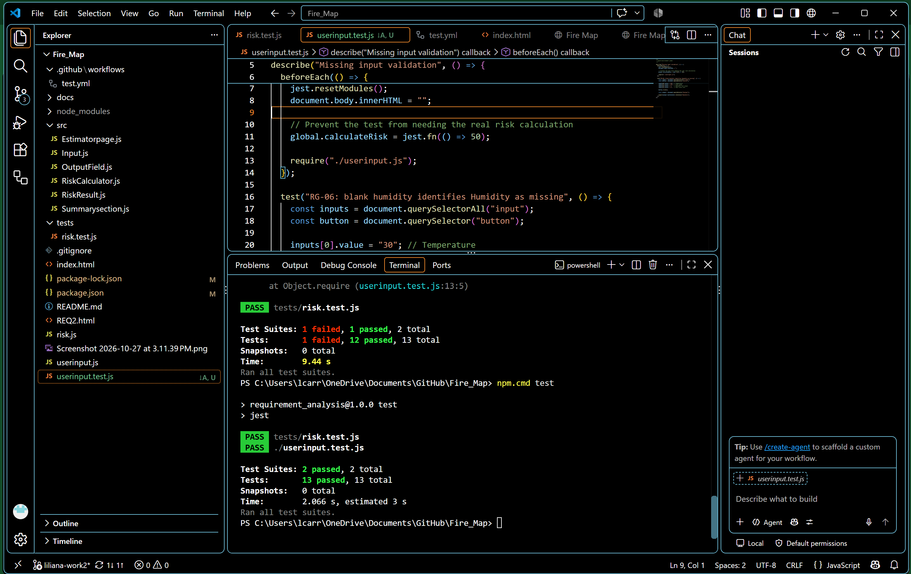
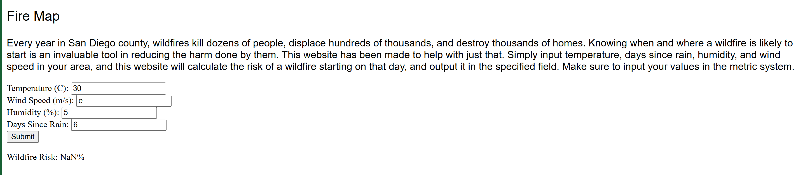
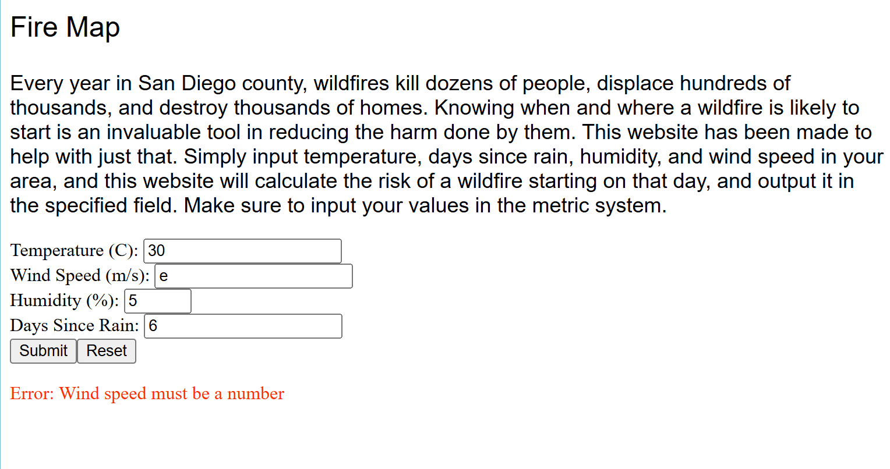

# Liliana Carrillo

## Bug Fix 1: Missing-input message

- Issue: [#89](https://github.com/dcardenas0302/Fire_Map/issues/89)
- Pull Request: [PR #___](PR-LINK)
- Test: RG-06 — blank input identifies the missing field
- File changed: `userinput.js`

This was a code bug because the requirement correctly expected the website to identify missing information, but the code did not display which field was blank.

### Before

![Issue #89 before fix] No prior display 

### After

## Bug Fix 2: Non-number inputs

- Issue: [#73](https://github.com/dcardenas0302/Fire_Map/issues/73)
- Pull Request: [PR #___](PR-LINK)
- Tests: LC-05, LC-06, LC-07, and LC-08
- Files changed: `risk.js` and `userinput.js`

This was a code bug because the tests correctly expected non-number inputs to be rejected, but the original code accepted or incorrectly handled them.

### Before

### After

## AI Disclosure

I used AI to help explain the testing process, organize the regression tests, and review possible validation changes. I verified the behavior, ran the tests, and made sure the final changes matched the project requirements.
