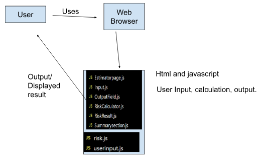

# Trace the Click: System Map

**Date:** October 22, 2026  
**Team:** Group 8  
**Inherited project:** Fire Map

## Team and Roles

| Role | Owns | Specific task | Name |
|---|---|---|---|
| Product Analyst | Part 1 and questions in Part 4 | Runs the app, chooses the user action, writes the purpose sentence, and collects questions for the original team. | Ryder Garcia |
| Architect | Part 2 and mismatches in Part 4 | Draws the as-built diagram from the code, compares it with the handoff UML, and records mismatches. | Liliana Carrillo |
| Frontend Tracer | Part 3, client side | Traces the action from the button click to the request leaving the client. | Noam Garibi, Jacobo Ramos |
| Backend Tracer | Part 3, server side | Traces the API route to the database and back to the response. | N/A - backend not implemented |

## Part 1: Purpose

The system lets users input temperature, wind speed, humidity, and days since rain so that the chance of a fire in their area can be calculated.

**User action traced:** Inputting the temperature, wind speed, humidity, and days since rain.

## Part 2: As-Built Architecture Diagram

The code evidence in the trace shows a browser-only application. The trace does not show a backend server, API route, database, or external service.

The architecture diagram shows the components supported by the code evidence:

1. The user enters values in the webpage.
2. `index.html` loads the client-side JavaScript files.
3. `userinput.js` sends the input values to `calculateRisk()`.
4. `risk.js` calculates and returns the risk value to the webpage.

No HTTP request, SQL query, database, backend server, or external API was found in the trace.

## Part 3: Trace the Click

The traced action is entering temperature, wind speed, humidity, and days since rain. The frontend trace and backend trace do not meet at an API endpoint because backend code was not implemented in the inherited project.

| Step | Layer | File and function | Data in / data out | Notes or surprises |
|---:|---|---|---|---|
| 1 | Frontend | `./index.html` | Loads `risk.js` and `userinput.js`. | The working website uses these JavaScript files directly. |
| 2 | Frontend | `./userinput.js` | Reads the temperature, humidity, wind speed, and days-since-rain inputs. | The form asks for four inputs. |
| 3 | Frontend | `./userinput.js` -> `calculateRisk(temp, humidity, windSpeed, daysSinceRain)` | Sends the four input values to the calculation function. | The calculation occurs inside the browser. |
| 4 | Frontend | `./risk.js` -> `calculateRisk(temp, humidity, wind, daysSinceRain)` | Returns a numeric fire-risk value. | The function accepts `temp`, but the current formula does not use it. |
| 5 | Frontend | `./userinput.js` | Receives the numeric result from `calculateRisk()`. | The result is sent back to the client-side code. |
| 6 | Backend | Not implemented | No API request or server response. | No backend route was found. |
| 7 | Database | Not implemented | No database read or write. | No database was found. |

## Part 4: Reality Check and Open Questions

### Mismatches between the handoff documentation and the working code

1. The handoff describes separate classes such as `EstimatorPage`, `InputUI`, and `RiskCalculator`, but `index.html` loads `risk.js` and `userinput.js` directly instead of using the new class structure.
2. The website asks for temperature, but `calculateRisk()` does not use temperature in its formula. It only uses humidity, wind speed, and days since rain.
3. The project has no backend server or database implementation, even though the tracing activity expected a backend and database path.

### Questions for the original team

1. **Intent:** Was temperature left out of the wildfire-risk calculation on purpose, or was it supposed to affect the output?
2. **Design:** Why are the separate classes in the `src/` folder not connected to the working website?
3. **Intent/design:** Was the application intentionally designed to calculate wildfire risk entirely inside the browser without a separate database or backend?

## Part 5: Candidate requirements
### A candidate requirement is your best guess at what the system should do, recovered from what the code does. It is a candidate until someone confirms it. Write at least five.
Every candidate requirement must:

1. Start with “The system shall…” and describe one behavior only. If you write “and,” split it in two.
2. Be testable. Write an acceptance criterion: a specific input and the result you expect. “The form should be user friendly” fails this rule.
3. Cite its source. Name the trace row, file, or function where you found it. If the code does not do it yet, say so.
4. Have a status. Pick one:
    - Confirmed: the code does it, and it is clearly intended.
    - Unconfirmed: you think it should be true, but you need the original team to confirm.
    - Suspected bug: the code does something that looks wrong.
5. Have a type. Functional (what it does) or non-functional (security, performance, usability).

Include at least one requirement of each status. The unconfirmed ones and suspected bugs are the most valuable. They are where your next sprint’s work comes from.

## Part 6: Three unit test cases
#### A unit test checks one function on its own, with no browser, server, or database involved. Your three test cases are your verification strategy in miniature: each one proves, or disproves, one of your candidate requirements.

Every test case must:

1. Trace to a candidate requirement by its ID (CR-1, CR-2, and so on).
2. Name the unit under test: one file and one function.
3. Give an exact input and an exact expected output. “It should work” is not an expected output.
4.Cover three different kinds of test across your set of three:
    - Positive: valid input is accepted.
    - Negative: invalid input is rejected.
    - Boundary: input right at the edge of a limit.
5. Predict pass or fail against the current code. A test you expect to fail is not a mistake. It documents a gap, and it becomes a backlog item.

You only need to write the test cases, not run them. If your team writes real test code, that is a bonus.